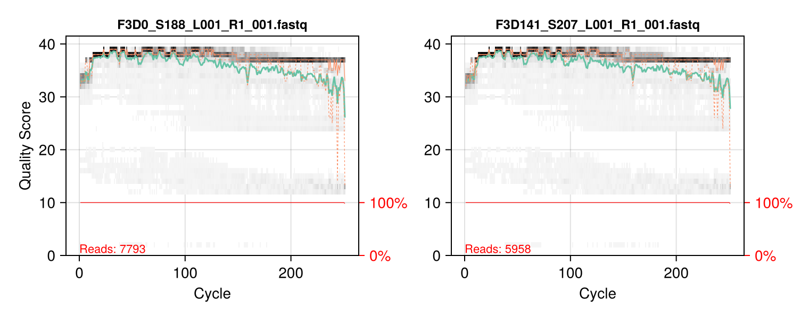
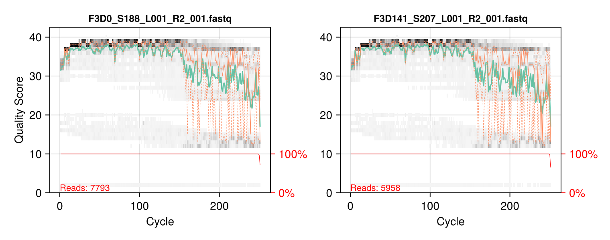
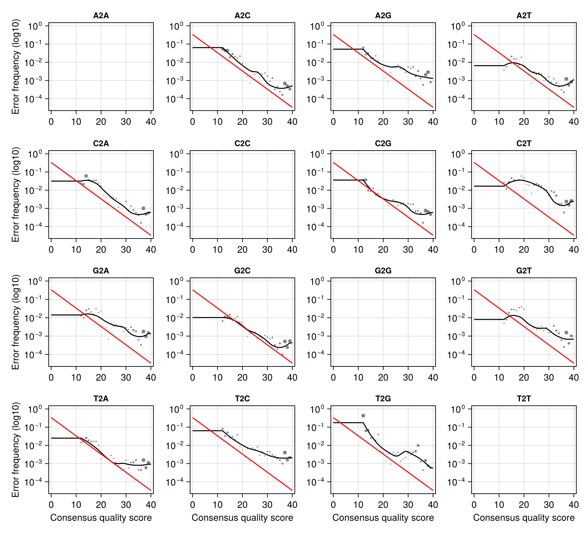
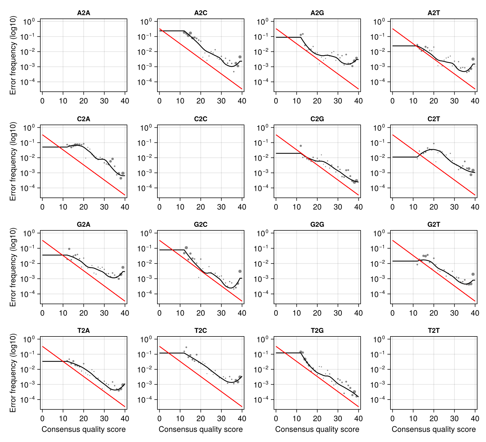
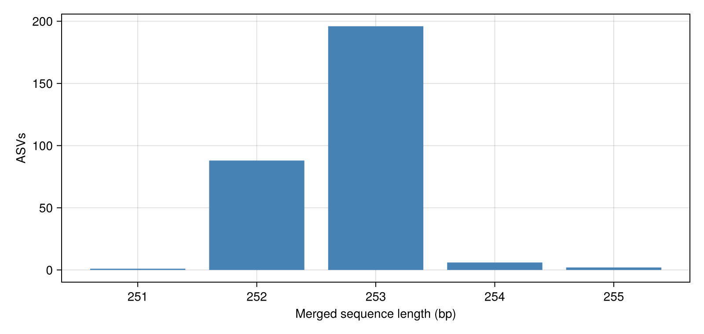
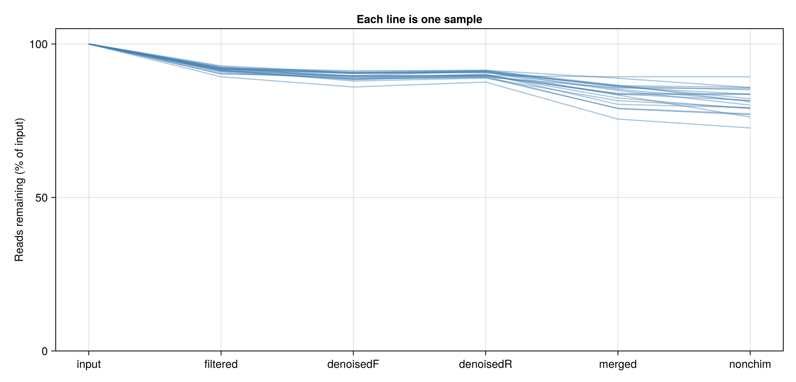
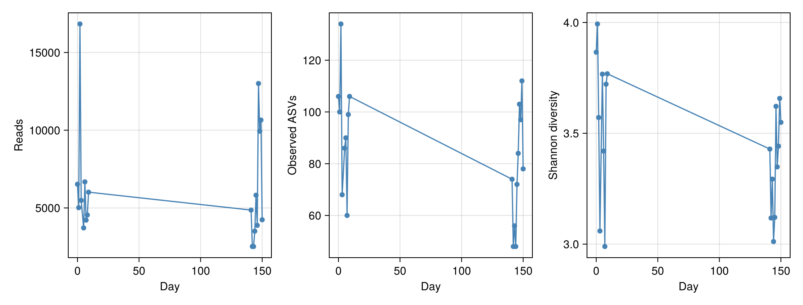

# Tutorial: the DADA2 workflow

This tutorial follows the
[DADA2 pipeline tutorial](https://benjjneb.github.io/dada2/tutorial.html)
step by step, in Julia. It turns paired-end Illumina MiSeq reads into a table
of amplicon sequence variants (ASVs) and assigns them a taxonomy. Function
names and options are those of the R package, so the R documentation applies
too.

You will produce a sample-by-ASV count table, a record of read retention,
diagnostic figures, and tables ready for ecological analysis. The figures below
are generated by Julia on the MiSeq SOP data, not copied from the R tutorial.
The R walkthrough is the conceptual companion; this page documents this Julia
implementation and its own outputs.

## Before you begin

Use demultiplexed paired FASTQ files with adapters and primers already removed.
Forward and reverse records must describe the same reads in the same order.
Do not independently reorder or filter the two directions. The supplied SOP
data meet these assumptions; a new sequencing run may need primer removal first.

This example is for the short 16S V4 region. Its trimming lengths are not defaults
for other targets, particularly variable-length ITS amplicons. Keep negative
controls and mock communities through processing so you can inspect them later.

For a reproducible run of the processing and figures, download
[`run.jl`](assets/tutorial/run.jl). From an environment containing DenoiseDNA,
DataFrames and CairoMakie, run:

```sh
julia -t 4 --project=. run.jl /path/to/MiSeq_SOP tutorial-output
```

The script writes PNG figures, read tracking, ASV counts, diversity summaries,
and a run summary. Taxonomy requires separately downloaded references and is
shown below rather than downloaded automatically. Rendered outputs are saved
with the docs so reading this page never launches a sequencing analysis.

The run shown here used Julia 1.11.1 and DenoiseDNA 0.2.0 on 15 November 2026:

| Checkpoint | Observed result |
|:--|--:|
| Samples, including the mock | 20 |
| ASVs before chimera removal | 293 |
| ASVs after chimera removal | 232 |
| Merged reads retained after chimera removal | 96.40% |
| Mock ASVs with an exact reference match | 20 of 20 |

These are results of the downloadable script on this specific dataset, not
thresholds your own data must meet.

## Setup

Start Julia with several threads (`julia -t auto`); steps called with
`multithread=true` use all of them.

```julia
using Pkg
Pkg.add(["DenoiseDNA", "AssignTaxonomy", "DataFrames", "CairoMakie"])

using DenoiseDNA, DataFrames
```

If the initial DenoiseDNA registration has not yet reached General, install
the committed release source directly before loading it:

```julia
Pkg.add(url="https://github.com/EvoArt/DenoiseDNA.jl",
        rev="4ce2258707a77ac307487597f2091e5567304ace")
Pkg.add(url="https://github.com/EvoArt/AssignTaxonomy.jl",
        rev="182ffeece7052a8d7328493ff3beb9e735a57cc5")
Pkg.add(["DataFrames", "CairoMakie"])
```

The taxonomy examples require AssignTaxonomy 0.2, rather than the previous
registered API. Use `Pkg.status()` to record what you installed. Working in
a dedicated project (`Pkg.activate("miseq-tutorial")`) keeps this environment
separate from other analyses.

## Data

The data are the 2x250 V4 16S rRNA reads of the
[mothur MiSeq SOP](https://mothur.org/wiki/miseq_sop/): gut samples from one
mouse, taken at time points after weaning, plus a mock community of 20
known strains. Download
[miseqsopdata.zip](https://mothur.s3.us-east-2.amazonaws.com/wiki/miseqsopdata.zip)
and unzip it.

```julia
path = "MiSeq_SOP"
fnFs = sort(filter(endswith("_R1_001.fastq"), readdir(path; join=true)))
fnRs = sort(filter(endswith("_R2_001.fastq"), readdir(path; join=true)))
sample_names = first.(split.(basename.(fnFs), "_"))
```

Check the pairing before processing anything:

```julia
@assert !isempty(fnFs) "No FASTQ files found: check path and file suffix"
@assert replace.(basename.(fnFs), "_R1_" => "_R2_") == basename.(fnRs)
@assert allunique(sample_names) "Sample names must be unique"
length(sample_names)  # 20 in this dataset, including Mock
```

For `.fastq.gz` inputs, change the suffix used to discover files. The functions
read compressed FASTQ directly. Use an explicit sample sheet for filenames that
do not follow this convention; do not silently truncate meaningful sample IDs.

Files are named `SAMPLENAME_XXX_R1_001.fastq` (forward) and `..._R2_001.fastq`
(reverse), so the sample name is everything before the first underscore.

## Inspect read quality

```julia
using CairoMakie
plotQualityProfile(fnFs[1:2])
```



Each panel is one file: a heatmap of quality scores at each cycle, with the
mean (green line) and the median and quartiles (orange lines). The forward
reads stay good to the end; trimming the last 10 cycles is a safe choice, so
they are truncated at 240.

```julia
plotQualityProfile(fnRs[1:2])
```



The reverse reads are worse, as is usual on the MiSeq, and quality falls
around cycle 160, so they are truncated there. The reads must still overlap
after truncation: this V4 amplicon is about 250 bp, and 240 + 160 leaves
plenty of overlap.

Dark regions contain more reads. Inspect more than the first two samples on
your own run: a good first sample cannot rule out a poor lane or library. A
Phred score of 30 corresponds to a nominal error probability of 0.001 per base.
The overlap budget is approximately `forward length + reverse length - insert
length`, using the biological insert after primer removal. Leave room for
length variation as well as the minimum overlap required by merging.

## Filter and trim

```julia
filtFs = joinpath.(path, "filtered", sample_names .* "_F_filt.fastq.gz")
filtRs = joinpath.(path, "filtered", sample_names .* "_R_filt.fastq.gz")

out = filterAndTrim(fnFs, filtFs, fnRs, filtRs; truncLen=(240, 160), maxN=0,
                    maxEE=(2, 2), truncQ=2, rm_phix=true, compress=true,
                    multithread=true)
```

```julia
first(out, 6)
sum(out.reads_out) / sum(out.reads_in)
```

Per-direction settings are given as `(forward, reverse)`. `maxEE` sets the
number of expected errors allowed in a read, a better filter than average
quality. Reads with any `N` are dropped (DADA2 needs none), as are reads that
match the phiX genome. `out` has the reads in and out for each sample.

Expected errors are the sum of `10^(-Q/10)` across bases. A pair is retained
only when both directions pass. If retention is poor, inspect which direction
has the quality problem before relaxing thresholds. Truncation can improve
quality but also remove the overlap you need later. Make one justified change
at a time and compare the resulting read-tracking table.

## Learn the error rates

```julia
errF = learnErrors(filtFs; multithread=true)
errR = learnErrors(filtRs; multithread=true)
```

`learnErrors` alternates between inferring the sample composition and
estimating the error rates until the two agree. It uses the first `1e8`
bases of the data by default (`nbases`).

```julia
plotErrors(errF; nominalQ=true)
```



```julia
plotErrors(errR; nominalQ=true)
```



Each panel shows one transition (e.g. `A2C`): the observed error frequencies
(points), the fitted rates (black line) and the rates implied by the quality
scores (red line). The fit should follow the points, and error rates should
fall as quality rises.

The diagonal labels denote correct calls and their panels are left blank in
this plot; the off-diagonal panels show substitution errors. The nominal line
is a reference, not a fitting target.
Sparse high-quality observations can be noisy, but broad disagreement between
points and the fitted curve warrants investigation. Learn separate models for
the two directions and, normally, for different sequencing runs. Increasing
`nbases` helps when the training subset is not representative.

## Sample inference

```julia
dadaFs = dada(filtFs, errF; multithread=true)
dadaRs = dada(filtRs, errR; multithread=true)
dadaFs[1]
```

Each [`DadaResult`](@ref) holds the denoised sequences and their abundances.
By default samples are processed independently; `pool=true` pools all of
them, and `pool=:pseudo` shares information between samples at a fraction of
the cost.

Dereplication is performed internally when you pass FASTQ paths: repeated reads
are collapsed before inference. You can use `derepFastq` explicitly when you need
to reuse the intermediate objects. An ASV is a resolved sequence, not necessarily
a species: different organisms can share a 16S fragment and one organism can
carry multiple 16S copies. Pooling changes sensitivity and should be reported
as an analysis choice.

## Merge paired reads

```julia
mergers = mergePairs(dadaFs, filtFs, dadaRs, filtRs; verbose=true)
first(mergers[1], 6)
```

Each forward read is merged with its reverse read when they overlap by at
least 12 bases with no mismatch. The result for each sample is a `DataFrame`
of merged sequences, with abundances and the indices of the forward and
reverse ASVs. Pairs that fail to merge are dropped (`returnRejects=true`
keeps them, marked `accept = false`).

Inspect `abundance`, `nmatch`, `nmismatch`, and `nindel` in this table. Merging
is done after denoising, rather than by concatenating raw reads. If it loses
many pairs, check pairing, amplicon length, orientation and trimming before
allowing mismatches. Concatenating non-overlapping reads is a different analysis
choice and does not recover the missing bases.

## Sequence table

```julia
seqtab = makeSequenceTable(mergers; names=sample_names)
size(seqtab)        # (20, 293)
```

A [`SequenceTable`](@ref) has a row per sample and a column per ASV;
`seqtab.table` holds the counts. The lengths of the merged sequences:

```julia
lens = length.(seqtab.sequences)
[l => count(==(l), lens) for l in sort(unique(lens))]
```



Nearly all fall within the expected range of the V4 amplicon. Sequences much
longer or shorter can come from non-specific priming and can be removed:

```julia
seqtab2 = seqtab[:, 250 .<= lens .<= 256]
```

This is an optional diagnostic example. The main workflow continues with
`seqtab` so its results can be compared with the unfiltered SOP workflow. If
you choose a length filter for your study, pass `seqtab2` into the next step
and record that choice. A length histogram counts distinct ASVs, not reads.

## Remove chimeras

```julia
seqtab_nochim = removeBimeraDenovo(seqtab; method="consensus", multithread=true, verbose=true)
size(seqtab_nochim)                       # (20, 232)
sum(seqtab_nochim.table) / sum(seqtab.table)
```

Chimeras are sequences made of a left part of one more abundant sequence and
a right part of another. Here they are a large share of the ASVs but only a
few percent of the reads.

Report both fractions: removing many rare ASVs can have little effect on the
number of reads. Chimera identification is sequence-based and does not replace
contamination assessment with negative controls.

## Track reads through the pipeline

```julia
track = DataFrame(sample = sample_names,
                  input = out.reads_in,
                  filtered = out.reads_out,
                  denoisedF = [sum(d.abundance) for d in dadaFs],
                  denoisedR = [sum(d.abundance) for d in dadaRs],
                  merged = [sum(m.abundance) for m in mergers],
                  nonchim = vec(sum(seqtab_nochim.table; dims=2)))
```

No step should lose most of the reads. A large loss at merging usually means
the reads were truncated too short to overlap; at chimera removal, that
primers were left on the reads.



The forward and reverse denoising counts are parallel branches, not successive
filters: a line can rise between them. Each curve is normalised to that sample's
input count. Inspect absolute depth too; similar percentages can hide a sample
with too few reads for the intended comparison. These diagnostics suggest
possible causes, rather than proving a cause on their own.

Download the [complete tracking table](assets/tutorial/read-tracking.tsv) and
[run summary](assets/tutorial/summary.txt) for the figures shown here.

The first six samples in this run were:

| Sample | Input | Filtered | Denoised F | Denoised R | Merged | Nonchimeric |
|:--|--:|--:|--:|--:|--:|--:|
| F3D0 | 7793 | 7113 | 6976 | 6979 | 6540 | 6528 |
| F3D141 | 5958 | 5463 | 5331 | 5357 | 4986 | 4863 |
| F3D142 | 3183 | 2914 | 2799 | 2830 | 2595 | 2521 |
| F3D143 | 3178 | 2941 | 2822 | 2868 | 2553 | 2519 |
| F3D144 | 4827 | 4312 | 4151 | 4228 | 3646 | 3507 |
| F3D145 | 7377 | 6741 | 6592 | 6627 | 6079 | 5820 |

## Assign taxonomy

Taxonomy is assigned with
[AssignTaxonomy.jl](https://github.com/EvoArt/AssignTaxonomy.jl), a port of
R's `assignTaxonomy` (the naive Bayesian classifier of Wang et al. 2007).
Download the Silva reference files formatted for DADA2 (see
[the DADA2 reference databases](https://benjjneb.github.io/dada2/training.html)):
`silva_nr99_v138.2_toGenus_trainset.fa.gz` and
`silva_v138.2_assignSpecies.fa.gz`.

```julia
using AssignTaxonomy

taxa = assignTaxonomy(seqtab_nochim, "silva_nr99_v138.2_toGenus_trainset.fa.gz")
taxa = addSpecies(taxa, "silva_v138.2_assignSpecies.fa.gz")
DataFrame(taxa)
```

Each row is an ASV, with a column per rank; ranks without enough bootstrap
support (`minBoot=50`) are `missing`. Species are assigned only by exact
matching. Even an exact short-fragment match can be shared by several species;
it does not establish a unique species identification.

Set `seed=1` in `assignTaxonomy` for reproducible bootstrap sampling, and record
the reference database version and filtering threshold. Missing assignments are
not zero abundance: they mean the classifier did not provide an assignment at
that rank under your settings. `tryRC=true` can help if sequence orientation is
uncertain. Inspect the results before using it as a routine substitute for
understanding the orientation of your amplicons.

The two reference files serve different purposes: the genus training set is
used by `assignTaxonomy`, while the species reference is used by `addSpecies`.
Do not swap them. Taxonomy examples here are executable instructions, not a
claim that a particular SILVA release was used to generate the plots above.

## Evaluate accuracy on the mock community

The sample `Mock` contains 20 known strains, whose sequences are in
`HMP_MOCK.v35.fasta`.

```julia
i = findfirst(==("Mock"), seqtab_nochim.samples)
mock = seqtab_nochim.sequences[seqtab_nochim.table[i, :] .> 0]
mock_ref = getSequences(joinpath(path, "HMP_MOCK.v35.fasta"))

length(mock)                                    # ASVs found in the mock
count(s -> any(r -> occursin(s, r), mock_ref), mock)   # exact matches
```

Check these values against the [recorded run summary](assets/tutorial/summary.txt).
The downloadable script checks both reference orientations. Count distinct
reference-matching ASVs, not recovered strains: several strains can share the
same amplified sequence. Exact matches assess sequence accuracy against this
reference, not the accuracy of the taxonomic labels. Examine unmatched ASVs
and their read abundance instead of assuming that every mismatch is a new
organism or a denoising error.

## Explore diversity without the mock control

The SOP sample names encode collection day after `F3D`. Extract this metadata
explicitly and sort days numerically rather than alphabetically:

```julia
keep = findall(s -> startswith(s, "F3D"), seqtab_nochim.samples)
days = parse.(Int, replace.(seqtab_nochim.samples[keep], "F3D" => ""))
order = sortperm(days)
keep, days = keep[order], days[order]
counts = seqtab_nochim.table[keep, :]
depth = vec(sum(counts; dims=2))
richness = vec(sum(counts .> 0; dims=2))
shannon = [begin
    p = row[row .> 0] ./ sum(row)
    -sum(p .* log.(p))
end for row in eachrow(counts)]

fig = Figure(size=(1000, 380))
for (j, (values, label)) in enumerate(((depth, "Reads"),
        (richness, "Observed ASVs"), (shannon, "Shannon diversity")))
    ax = Axis(fig[1, j]; xlabel="Day", ylabel=label)
    scatterlines!(ax, days, values)
end
fig
```



This is an exploratory view of one mouse over time, not independent replicates
of a treatment. Observed richness depends on sequencing depth; Shannon diversity
also reflects evenness and uses natural logarithms here. Lines connect observed
days, including gaps in sampling. Do not interpret these curves as a significance
test or infer a population-level treatment effect from this example.

## Export results with explicit identifiers

Keep the sequence strings as the joining key, or assign stable ASV IDs and save
their mapping. Never join taxonomy to counts by current row position after
sorting or filtering either table.

```julia
using CSV
CSV.write("read-tracking.csv", track)
CSV.write("asv-counts-long.csv", DataFrame(seqtab_nochim))
taxdf = DataFrame(taxa)
CSV.write("taxonomy.csv", taxdf)

# DenoiseDNA uses lowercase sequence; AssignTaxonomy uses Sequence.
annotated = leftjoin(DataFrame(seqtab_nochim), taxdf;
                     on=:sequence => :Sequence)
CSV.write("annotated-counts.csv", annotated)
```

Install CSV with `Pkg.add("CSV")` if needed. The long count table contains
nonzero entries; an absent sample/ASV combination represents zero reads. Keep
raw integer counts for methods that require them. Relative abundance is a
within-sample proportion and cannot be interpreted as absolute microbial load.

Save your environment's `Project.toml` and `Manifest.toml`, the exact commands,
the sample metadata, and reference database versions with the results. The
standalone script writes TSV files without requiring CSV and can regenerate
all seven diagnostic figures shown on this page.

## Next steps

The sequence table, taxonomy table and sample data are what most community
analyses start from. `DataFrame(seqtab_nochim)` gives the counts in long
form (`sample`, `sequence`, `abundance`), and `DataFrame(taxa)` the
taxonomy, ready to join on the sequence.
